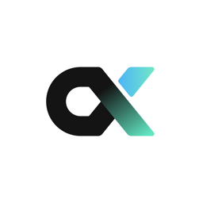
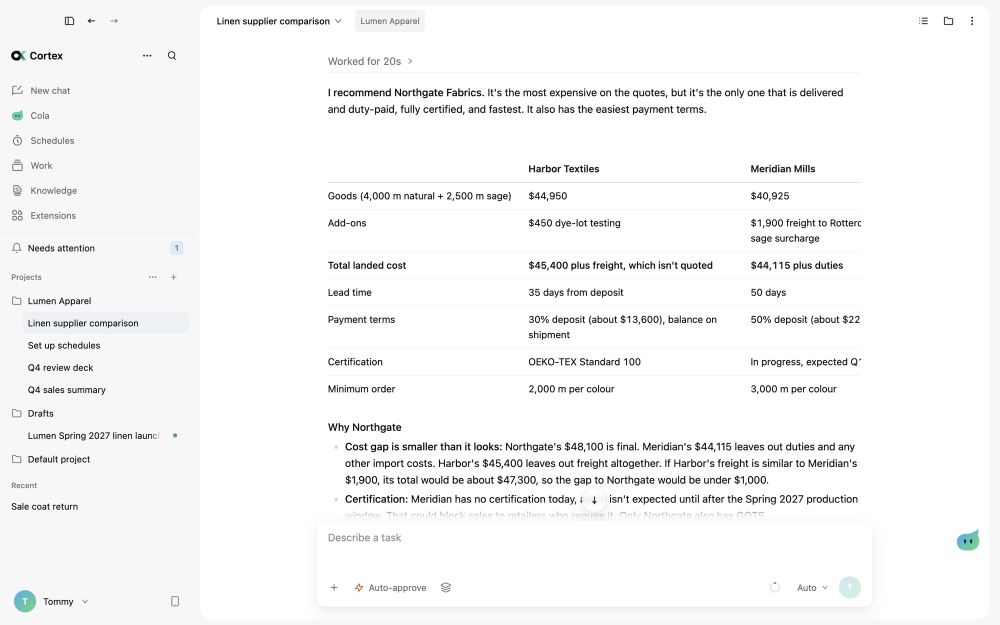
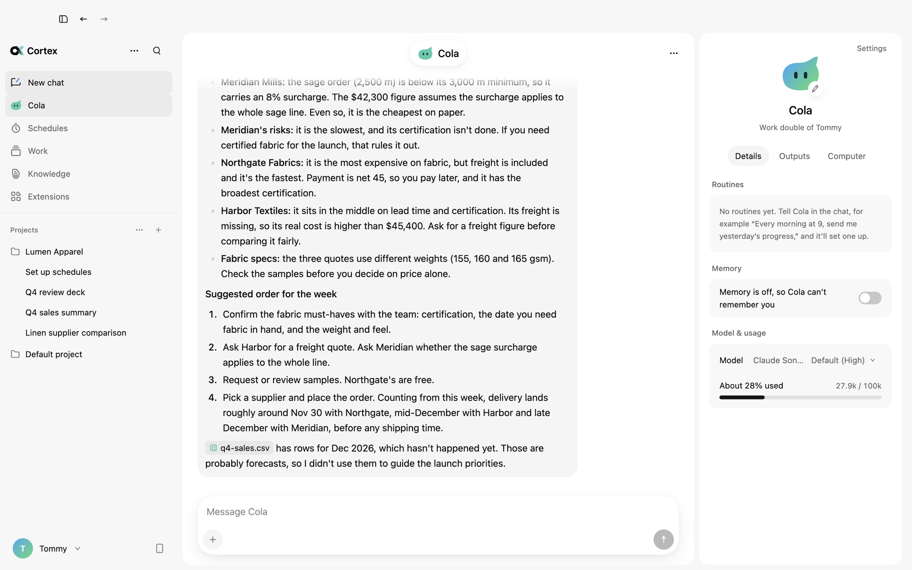
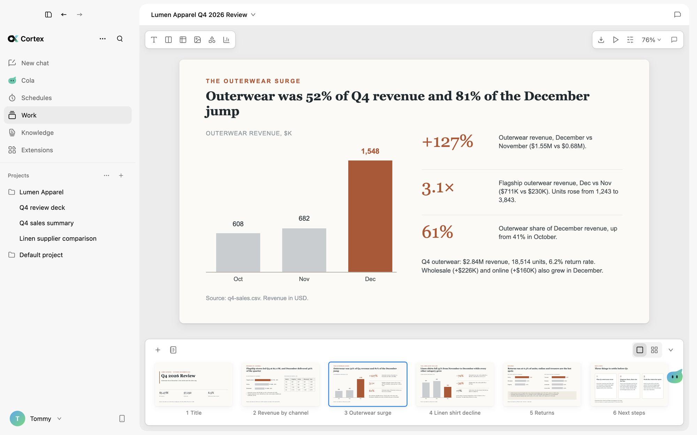
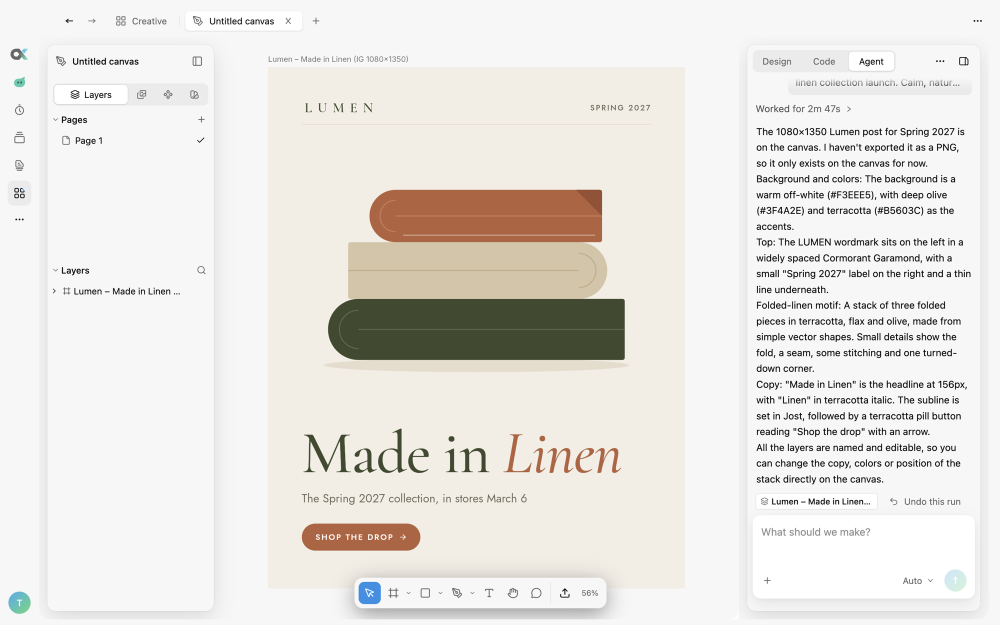
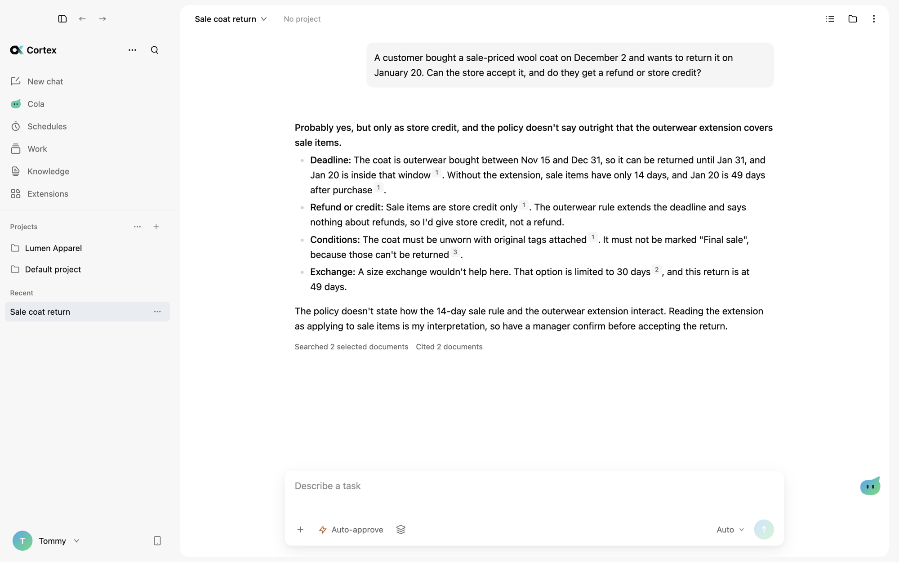
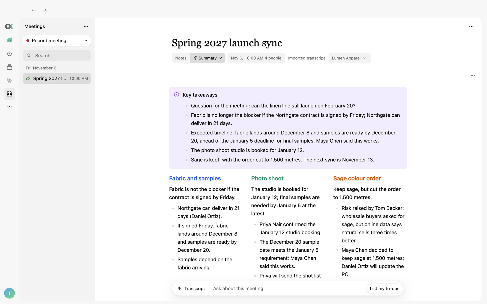
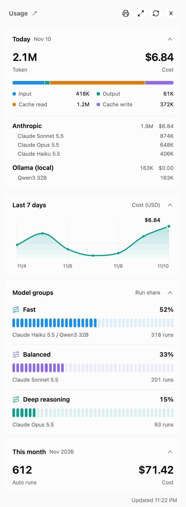
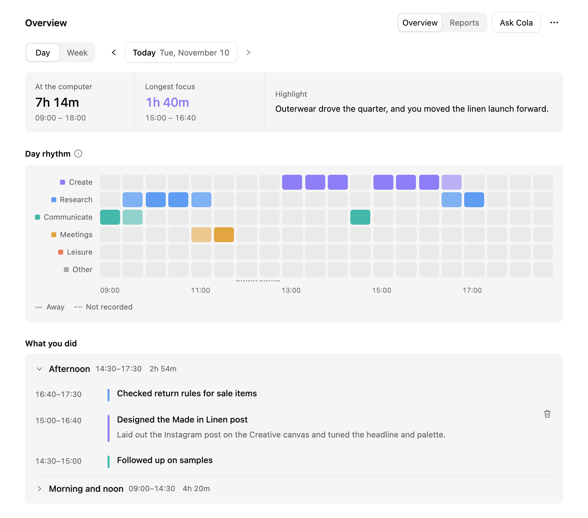

# Cortex

**Beyond a general AI workspace.** 
Your models, your data, your machine. A local-first AI workspace where agents work across your files, editable documents, knowledge, creative canvas, and team chats — with you in control.

English · [简体中文](README.zh-CN.md)

[-0ea5e9)](https://cortex.flock.io/#models)

 

  &nbsp;&nbsp;
  &nbsp;&nbsp;
  

[**Website**](https://cortex.flock.io) · [**Docs**](https://cortex.flock.io/docs/) · [**Download**](#download) · [**Why Cortex**](#why-cortex) · [**Highlights**](#highlights) · [**Updates**](#updates) · [**Talk to us**](mailto:hello@flock.io)

 

  

> [!NOTE]
> **Free to download, bring your own API keys.** Conversations, projects, knowledge bases, and meeting recordings stay on your Mac. Connect Claude, GPT, Gemini, DeepSeek, Kimi, Qwen, GLM, MiniMax, Seedance, or any OpenAI-compatible local/cloud endpoint. Need a custom workflow or private deployment for your team? Email [**hello@flock.io**](mailto:hello@flock.io).

---

## Why Cortex

Most agent harnesses stop at a loop: a model, some tools, and a prompt. **Cortex is the workspace around that loop.**

🏠 **Local-first by default.** Conversations, projects, knowledge libraries, and settings live in folders on your Mac. A request leaves your machine only when it goes to the model provider or online connector you explicitly configure. Meeting transcription and document redaction can run completely on device.

🤖 **Cola, your personal agent on Mac and iPhone.** Cola runs long-running goals and scheduled routines on your Mac and reports back when something changes. Message it from your iPhone, WeChat, Feishu / Lark, DingTalk, or Telegram and keep working while you are away.

📄 **Editable work, not dead chat bubbles.** Ask for a report, slide deck, data dashboard, or poster. The agent builds real documents, slides, dashboards, and multi-layer design canvases that you keep editing in place — with one-click export to Word, PowerPoint, PDF, PNG, SVG, or Figma.

⚡ **Bring your models, routed in ~400 ms.** Use your own API keys and pay providers directly. In Auto mode, `this-that` — the lightweight decision model from [FLock.io](https://www.flock.io) — picks the right model tier for each step in ~400 ms so you spend less and wait less.

🛡️ **Permissions you control.** Choose **Ask for approval**, **Auto-approve**, or **Plan** per conversation. Risky or outbound actions pause for your confirmation before anything is deleted or sent.

---

## Download

  &nbsp;&nbsp;
  &nbsp;&nbsp;
  

| Platform | Architecture | Package | Status |
| :--- | :--- | :--- | :--- |
| **macOS 13+** (Ventura or later) | Apple Silicon (M1 / M2 / M3 / M4) | [**Latest `.dmg` installer**](https://github.com/FLock-io/cortex-releases/releases/latest) | ✅ Available |
| **Windows** | x64 / ARM64 | Installer | 🚧 Coming soon |
| **Linux** | x64 (`AppImage` / `.deb`) | Package | 🚧 Coming soon |

### Quick install (macOS)

1. Open the [latest release](https://github.com/FLock-io/cortex-releases/releases/latest) and download `Cortex-<version>-arm64.dmg`.
2. Open the `.dmg` and drag **Cortex** into **Applications**.
3. Launch **Cortex** from Applications and follow the setup to connect a model (or skip and configure later in **Settings › Models & providers**).

The release is Developer ID–signed and notarized by Apple. Office and creative editors, local speech models, and knowledge-search models download on demand; Cortex verifies every component against a pinned digest.

---

## Highlights

### Cola, your personal agent

Cola works alongside you across your projects and conversations. Describe a routine in plain language — such as *"every morning at 9, summarize yesterday's progress and send it to me"* — and Cola sets it up, runs it on schedule, and comes back when there is progress or a decision to make.

  

### Editable documents, slide decks, and dashboards

Create rich documents, presentations, and interactive dashboards directly inside a conversation. Keep editing them side-by-side with the agent, undo any agent edit, and export to `.docx`, `.pptx`, PDF, or HTML.

  

### Creative canvas

A native design canvas built into the workspace. Generation nodes act as artboards, any layer can be referenced, and every version stays inside its node. Ask the agent to design posters, social assets, or layouts directly on the canvas — layers remain named and editable.

  

### Source-backed knowledge & on-device meeting notes

Add policies, contracts, and manuals to your local knowledge base; every answer cites the exact page it came from, and citations are checked before you see them. Record meetings with on-device transcription, speaker separation, and action items linked back to the transcript.

  
  

### Model routing and cost transparency

In Auto mode, a lightweight classifier routes each task to the model group that fits: fast, balanced, or deep reasoning. The usage panel tracks today's tokens and known cost, a seven-day trend, and how runs split across groups and models — calculated locally on your Mac.

  

### Computer history and daily summaries

Optionally, Cortex keeps a local record of which apps you used and, every 10 minutes, a short summary of what you were doing. The overview shows your time at the computer, your longest focus, a day rhythm by category, and a plain-language timeline. Off by default; pause, exclude apps, or clear anytime.

  

*Screenshots use fictional sample data.*

### Also in Cortex

- **Permissions you choose.** Use **Ask for approval**, **Auto-approve**, or **Plan** for each conversation. Optional **Full access** is gated separately in Settings for attended desktop and CLI runs.
- **Computer use.** Let an agent operate apps on your Mac with per-app permission prompts.
- **Skills and MCP connectors.** Connect Feishu, Notion, GitHub, Linear, Google Drive, Jira, databases, and any MCP server once for all conversations.
- **Chat bots.** Connect WeChat, Feishu / Lark, DingTalk, and Telegram to message your agent from your phone.

---

## Updates

Cortex updates itself automatically. With automatic updates enabled, the app checks shortly after launch and every four hours, downloads new versions in the background, and installs them the next time you quit. You can also check manually in **Settings › Notifications & chats › Software update**.

Full release notes for each version are published on the [**Releases**](https://github.com/FLock-io/cortex-releases/releases) page and the [**What’s new**](https://cortex.flock.io/docs/changelog/) page.

---

## System requirements

- **OS:** macOS 13 Ventura or later
- **Chip:** Apple Silicon (M1, M2, M3, M4, or later)
- **Models:** An API key for at least one model provider (or a local OpenAI-compatible server such as Ollama / LM Studio) added in **Settings › Models & providers**

Intel Macs, Windows, and Linux are not supported yet.

---

## Enterprise & Custom Builds

Beyond the standard desktop release, **FLock.io** builds Cortex around your team's workflows:

- **Private deployment** — on-premises servers, private VPC, or offline installers.
- **Custom agent harness** — internal MCP connectors, domain skills, and human sign-off checkpoints.
- **Proprietary models** — fine-tuned open-weight models (Qwen, DeepSeek, GLM) and federated learning when data cannot move.
- **Enterprise permissions** — multi-tier access control mapped to your org chart.

Learn more at [**cortex.flock.io**](https://cortex.flock.io/#custom) or contact us at [**hello@flock.io**](mailto:hello@flock.io).

---

## Support

- **Documentation:** [cortex.flock.io/docs](https://cortex.flock.io/docs/)
- **Bug reports & feature requests:** [Open an issue](https://github.com/FLock-io/cortex-releases/issues/new) with your Cortex version (**Settings › Notifications & chats › Software update**), macOS version, and reproduction steps. Please search [existing issues](https://github.com/FLock-io/cortex-releases/issues) first.
- **Business & custom builds:** [hello@flock.io](mailto:hello@flock.io)

## About this repository

This repository hosts official Cortex release builds, documentation links, and issue tracking.

© 2026 [FLock.io](https://www.flock.io). All rights reserved.
