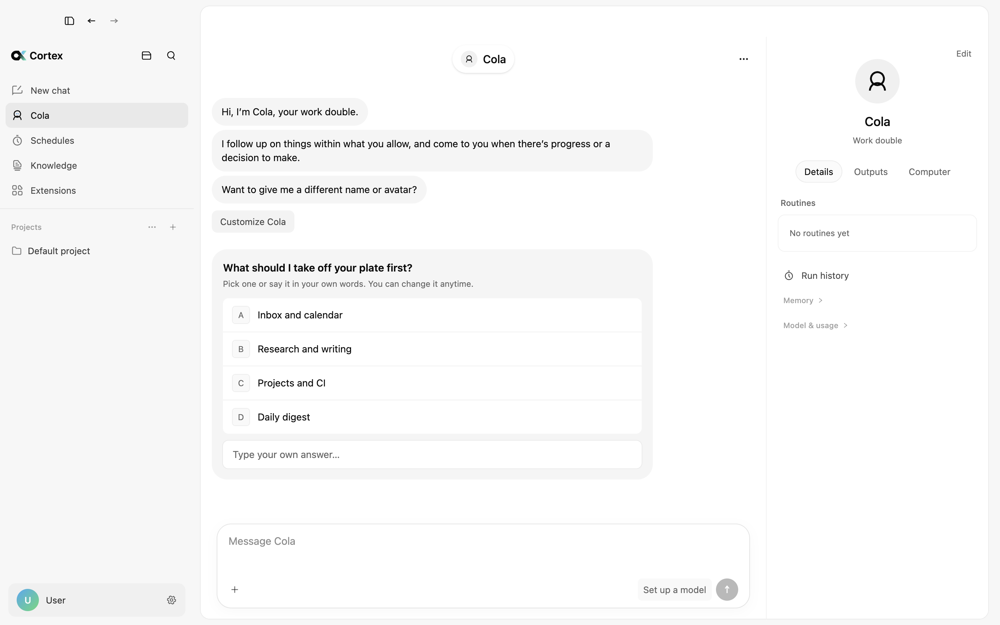

  

<h1 align="center">Cortex</h1>

  <strong>Not just another agent harness.</strong>

  A local-first AI workspace where agents work across your files, knowledge, apps, and chats — with you in control.

  
  
  

  <a href="#download">Download</a>
  ·
  <a href="#features">Features</a>
  ·
  <a href="#updates">Updates</a>
  ·
  <a href="#system-requirements">System requirements</a>
  ·
  <a href="#support">Support</a>

  

## About

Most agent harnesses stop at a loop: a model, some tools, and a prompt. Cortex is the workspace around that loop. It gives the agent a place to work — projects and files, a verified knowledge base, a creative canvas, your desktop, and the chat apps your team already uses — and it keeps you in charge of what the agent may do.

Everything runs on your computer. Conversations, projects, and settings are stored locally, and requests go only to the model providers you configure.

## Download

Get the installer for your computer from the [latest release](https://github.com/FLock-io/cortex-releases/releases/latest).

| Platform | Package |
| --- | --- |
| macOS 13 or later, Apple silicon | `Cortex-<version>-arm64.dmg` |
| macOS 13 or later, Intel | `Cortex-<version>.dmg` |
| Windows 10 or later, 64-bit | `Cortex-Setup-<version>.exe` |

**macOS**

1. Open the `.dmg` and drag **Cortex** into **Applications**. Open it from there, not from the disk image, so it can update itself.
2. On first launch, if macOS says the app can't be verified, open **System Settings › Privacy & Security** and click **Open Anyway**. Builds are ad-hoc signed and not yet notarized.

**Windows**

1. Run `Cortex-Setup-<version>.exe`.
2. If SmartScreen shows "Windows protected your PC", click **More info › Run anyway**. The installer is not code-signed yet.

## Features

- **Cola, your work double.** A personal agent that follows up on work within the scope you allow, reads across your projects and conversations, and comes back when there is progress or a decision to make.
- **Agents with guardrails.** Choose **Ask for approval**, **Auto-approve**, or **Plan** for each conversation. Shell commands run in a write sandbox, and irreversible actions always need your confirmation.
- **Verified enterprise knowledge.** Answers cite their sources, and every citation is checked against the original document before it is shown.
- **Creative canvas.** Connect text, image, and generation nodes to produce images and video, keep every version inside its node, and run a selected chain after previewing it.
- **Computer use.** Let an agent operate apps on your Mac, with per-app permission prompts and one conversation in control at a time.
- **Skills and MCP connectors.** Install a dependency once and every conversation can use it. When a connector fails to start, Cortex shows why.
- **Bots for WeChat, Feishu, and DingTalk.** Send tasks from your phone and get results back in the same chat.
- **Built for daily work.** A per-conversation terminal, voice input with live transcription, subagents and background tasks, and automatic model routing.

## Updates

Cortex updates itself from this repository. The app checks for a new release 10 seconds after launch and every four hours, and downloads it in the background. When the update is ready, a restart prompt appears at the bottom of the sidebar; click it and Cortex reopens on the new version. **Settings › Notifications & chats › About** shows your current version and lets you check manually.

On macOS, the update replaces the copy in **Applications** and asks for an administrator password only if your account can't write to that folder. On Windows, the installer runs silently and relaunches Cortex.

Copies installed before automatic updates were added need one manual update: download the latest release and install it over the old version.

Release notes for each version are on the [Releases](https://github.com/FLock-io/cortex-releases/releases) page.

## System requirements

- macOS 13 Ventura or later on Apple silicon or Intel, or Windows 10 or later (64-bit)
- An API key for at least one model provider, added in **Settings › Models & providers**

Linux builds are not available yet.

## Support

Found a bug or have a feature request? [Open an issue](https://github.com/FLock-io/cortex-releases/issues/new) with your Cortex version (shown under **Settings › Notifications & chats › About**), your operating system version, and the steps to reproduce it. Please search [existing issues](https://github.com/FLock-io/cortex-releases/issues) first.

## About this repository

This repository hosts release builds of Cortex and serves as its update feed. New versions are published here automatically when a release is tagged. It does not contain source code.

© FLock.io. All rights reserved.
