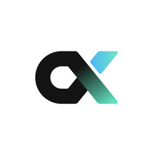
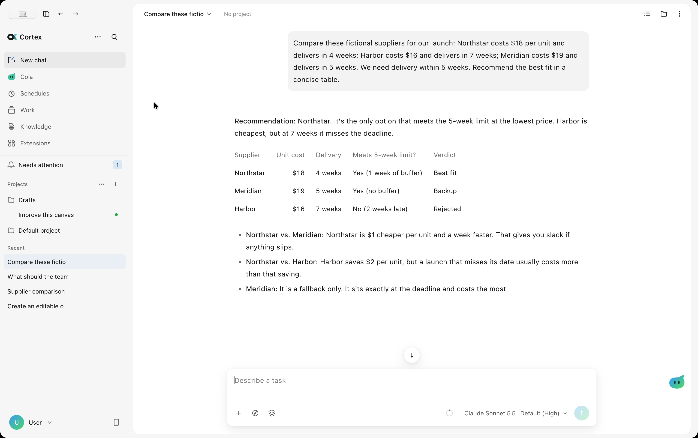
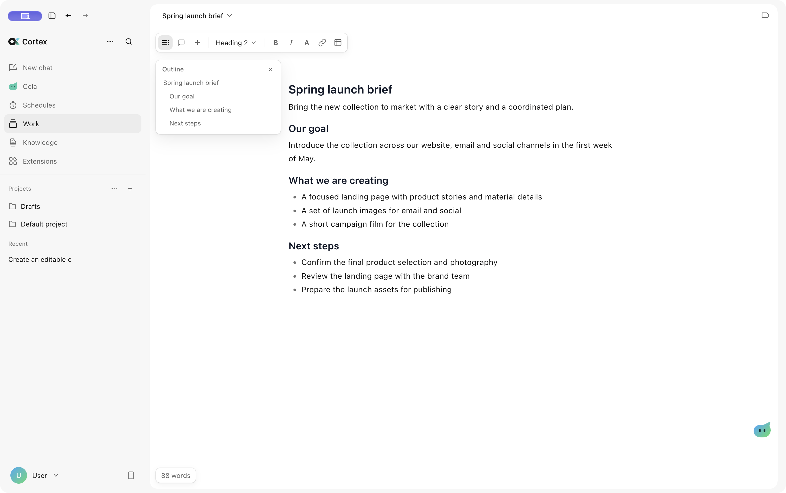
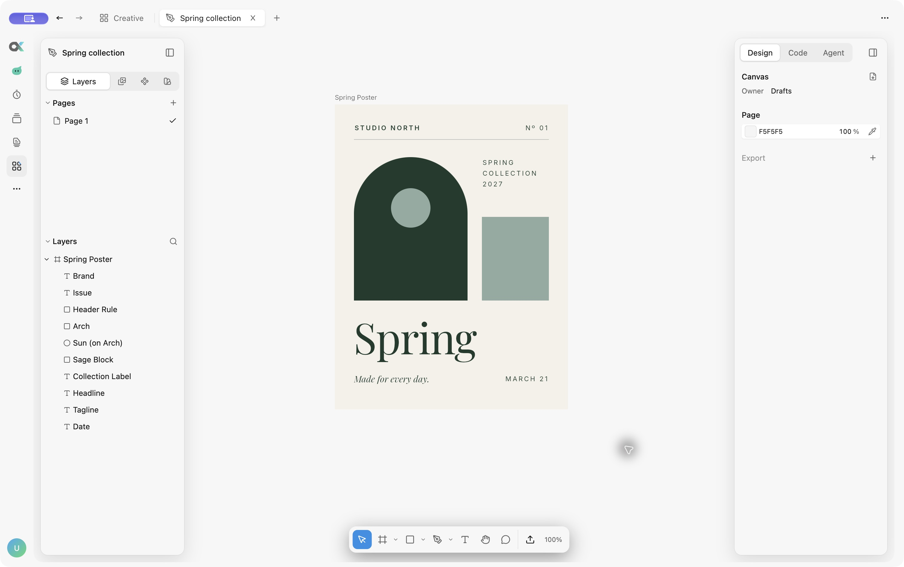

# Cortex

**Beyond a general AI workspace.**

A local-first AI workspace for your models, files, knowledge, and creative work. Built by [FLock.io](https://www.flock.io/).

English · [简体中文](README.zh-CN.md)

[Website](https://cortex.flock.io/) · [Documentation](https://cortex.flock.io/docs/) · [Downloads](#download) · [Release notes](https://github.com/FLock-io/cortex-releases/releases) · [Feedback](https://github.com/FLock-io/cortex-releases/issues)

## What you can do

- Work with agents across your files and projects, using your own models and API keys.
- Create and edit documents, presentations, dashboards, and designs with your agent.
- Search local knowledge with citations, connect tools through skills and MCP, and run scheduled tasks with Cola.
- Record and transcribe meetings locally on macOS. Use model routing and usage insights to manage costs.

  
  

*Screenshots use fictional sample data. Features may vary by platform.*

## Download

| Platform | Availability |
| --- | --- |
| macOS 13+ · Apple Silicon | [Download the latest release](https://github.com/FLock-io/cortex-releases/releases/latest) |
| Linux · x64 | [Download AppImage or .deb (0.10.1608)](https://github.com/FLock-io/cortex-releases/releases/tag/0.10.1608) |
| Windows · x64 | [Download the installer (0.10.1608)](https://github.com/FLock-io/cortex-releases/releases/tag/0.10.1608) |

The latest release may not contain packages for every platform. Cortex is free to download; model provider charges may apply. Connect an API key or a compatible local model to get started.

## Support

Read the [documentation](https://cortex.flock.io/docs/), report a problem through [GitHub Issues](https://github.com/FLock-io/cortex-releases/issues), or contact [hello@flock.io](mailto:hello@flock.io) about business and custom builds.

© 2026 [FLock.io](https://www.flock.io/). All rights reserved.
