  

<h1 align="center">Cortex</h1>

  <strong>Not just another agent harness.</strong>

  A local-first AI workspace where agents work across your projects, files, and knowledge — with you in control.

  
  
  

  <a href="#download">Download</a>
  ·
  <a href="#features">Features</a>
  ·
  <a href="#updates">Updates</a>
  ·
  <a href="#system-requirements">System requirements</a>
  ·
  <a href="#support">Support</a>

## About

Cortex is a desktop workspace built around an AI agent. Every conversation is an agent session that can work in your projects and files, answer from a verified knowledge base, search the web, and pick up tasks from the chat apps your team already uses — while you decide what it is allowed to do.

Conversations, projects, knowledge libraries, and settings are stored on your computer, and requests go only to the model providers you configure.

## Download

Get the installer for your computer from the [latest release](https://github.com/FLock-io/cortex-releases/releases/latest).

| Platform | File |
| --- | --- |
| macOS 12 or later, Apple silicon | `Cortex-<version>-arm64.dmg` |
| macOS 12 or later, Intel | `Cortex-<version>.dmg` |
| Windows 10 or later, 64-bit | `Cortex-Setup-<version>.exe` |

**macOS**

1. Open the `.dmg` and drag **Cortex** into **Applications**. Run it from there, not from the disk image, so it can update itself.
2. The first time you open it, macOS may say the app can't be verified. Open **System Settings › Privacy & Security** and click **Open Anyway**. Builds are ad-hoc signed and not yet notarized.

**Windows**

1. Run `Cortex-Setup-<version>.exe`.
2. If SmartScreen shows "Windows protected your PC", click **More info › Run anyway**. The installer is not code-signed yet.

## Features

- **Agent conversations.** Start a conversation on its own or inside a project. The agent reads and edits files, runs commands, searches and reads the web, and generates images.
- **You stay in control.** Choose **按需确认** (ask for approval), **自动执行** (auto-approve), or **计划模式** (plan) for each conversation. Irreversible commands always need your confirmation.
- **Verified enterprise knowledge.** Import documents into knowledge libraries with version history, preview PDFs, Office files, and images in their original layout, and build Wiki pages from them. Answers cite their sources, and every citation is checked against the document version it came from.
- **Skills and MCP connectors.** Install them once in **扩展中心** and every conversation can use them.
- **Subagents and background tasks.** An agent can split work across parallel subagents. The **后台任务** panel shows progress, tokens, and cost, and lets you stop a whole conversation or a single subagent.
- **Scheduled tasks.** Run an agent once, at a fixed interval, daily, on weekdays, or weekly, in a new conversation or one that keeps following up.
- **Bots for Feishu, DingTalk, and WeChat.** Send tasks from your phone and get results back in the same chat.
- **Your choice of models.** Anthropic, OpenAI, Google, DeepSeek, Moonshot, Zhipu, MiniMax, Doubao, Qwen, or any OpenAI-compatible endpoint, with proxy support. API keys are encrypted on your device.
- **Built-in de-identification.** Find and redact sensitive information in documents with the **脱敏** workbench.

## Updates

Cortex updates itself from this repository. The app checks for a new release 10 seconds after launch and every four hours, downloads it in the background, and shows **重启更新** at the bottom of the sidebar when it is ready. Click it and Cortex restarts into the new version.

**设置 › 通知与会话 › 关于** shows your current version and lets you check manually.

Cortex 0.10.35 and earlier cannot update themselves. Install the latest release once by hand; later versions update automatically.

Release notes for each version are on the [Releases](https://github.com/FLock-io/cortex-releases/releases) page.

## System requirements

- macOS 12 Monterey or later (Apple silicon or Intel), or Windows 10 or later (64-bit)
- An API key for at least one model provider, added in **设置 › 模型与供应商**

Linux builds are not available yet.

## Support

Found a bug or have a feature request? [Open an issue](https://github.com/FLock-io/cortex-releases/issues/new) with your Cortex version (shown in **设置 › 通知与会话 › 关于**), your operating system version, and the steps to reproduce it. Please search [existing issues](https://github.com/FLock-io/cortex-releases/issues) first.

## About this repository

This repository hosts release builds of Cortex and serves as its update feed. It does not contain source code.

© FLock.io. All rights reserved.
