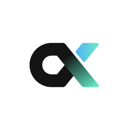
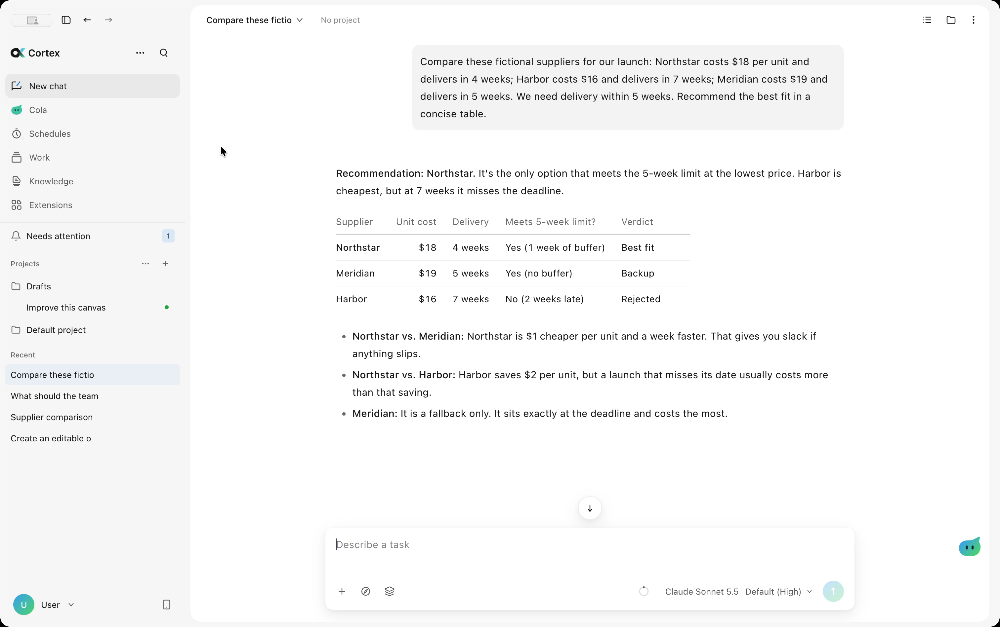
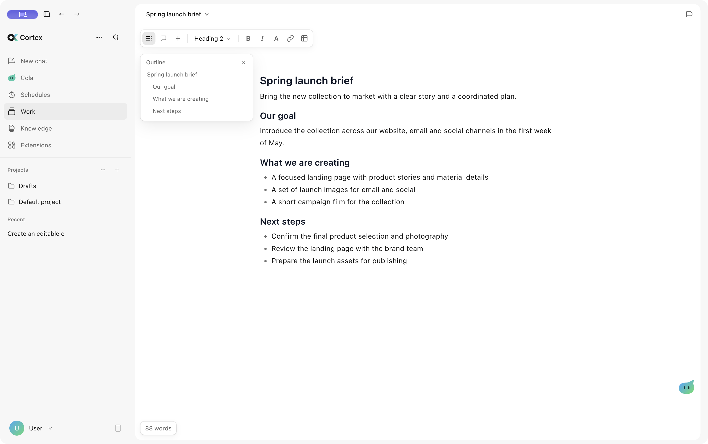
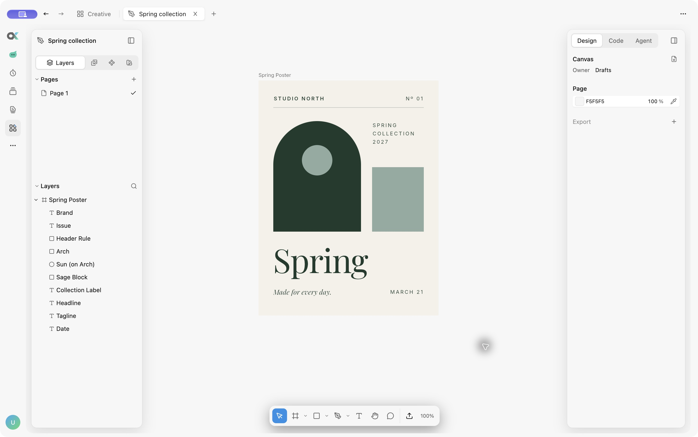

# Cortex

**不止于通用 AI 工作台。**

本地优先的 AI 工作台，让模型、文件、知识与创作汇聚在一起。由 [FLock.io](https://www.flock.io/) 打造。

[English](README.md) · 简体中文

[官网](https://cortex.flock.io/) · [帮助文档](https://cortex.flock.io/docs/) · [下载安装](#下载安装) · [更新日志](https://github.com/FLock-io/cortex-releases/releases) · [问题反馈](https://github.com/FLock-io/cortex-releases/issues)

## 你可以用 Cortex 做什么

- 使用自己的模型和 API Key，让智能体处理文件与项目。
- 与智能体共同创建、编辑文档、演示文稿、数据看板和设计。
- 搜索带来源引用的本地知识，通过 Skills 和 MCP 连接工具，让 Cola 执行定时任务。
- 在 macOS 上本地录制和转写会议，通过模型路由与用量面板管理成本。

  
  

*截图使用虚构示例数据。不同平台的功能可能有所差异。*

## 下载安装

| 平台 | 下载状态 |
| --- | --- |
| macOS 13+ · Apple Silicon | [下载最新版本](https://github.com/FLock-io/cortex-releases/releases/latest) |
| Linux · x64 | [下载 AppImage 或 .deb（0.10.1608）](https://github.com/FLock-io/cortex-releases/releases/tag/0.10.1608) |
| Windows · x64 | [下载安装程序（0.10.1608）](https://github.com/FLock-io/cortex-releases/releases/tag/0.10.1608) |

最新发布版本不一定包含所有平台的安装包。Cortex 可免费下载，模型服务商可能收取费用；配置 API Key 或兼容的本地模型即可开始使用。

## 支持与反馈

查看[帮助文档](https://cortex.flock.io/docs/)，通过 [GitHub Issues](https://github.com/FLock-io/cortex-releases/issues) 反馈问题，或联系 [hello@flock.io](mailto:hello@flock.io) 咨询商务合作与定制。

© 2026 [FLock.io](https://www.flock.io/). 保留所有权利。
