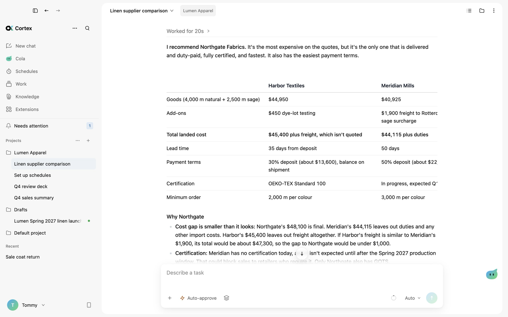
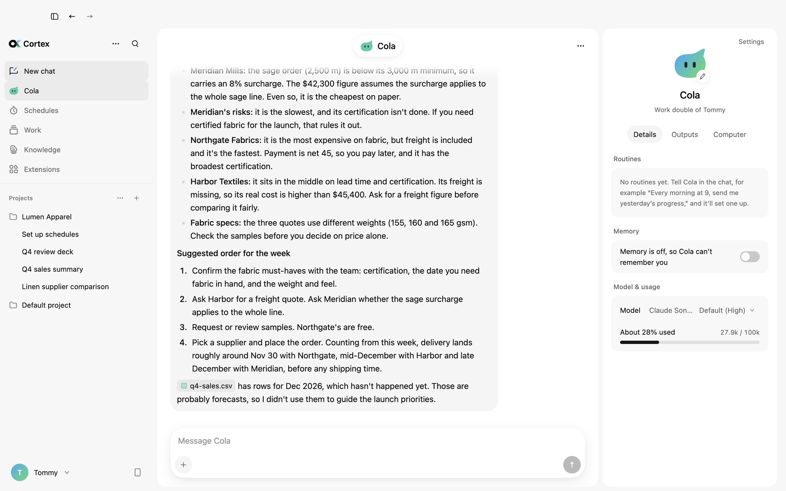
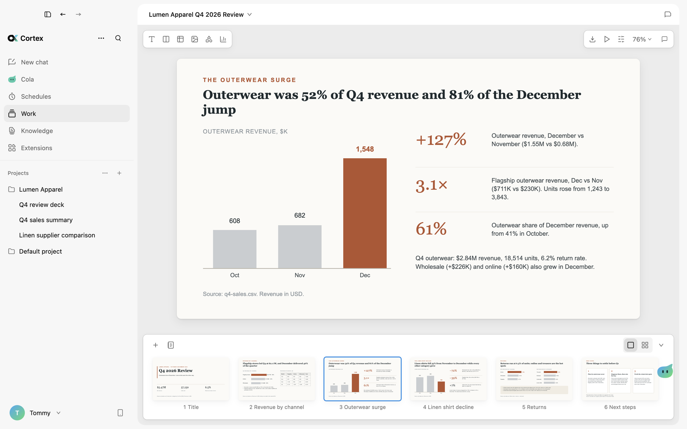
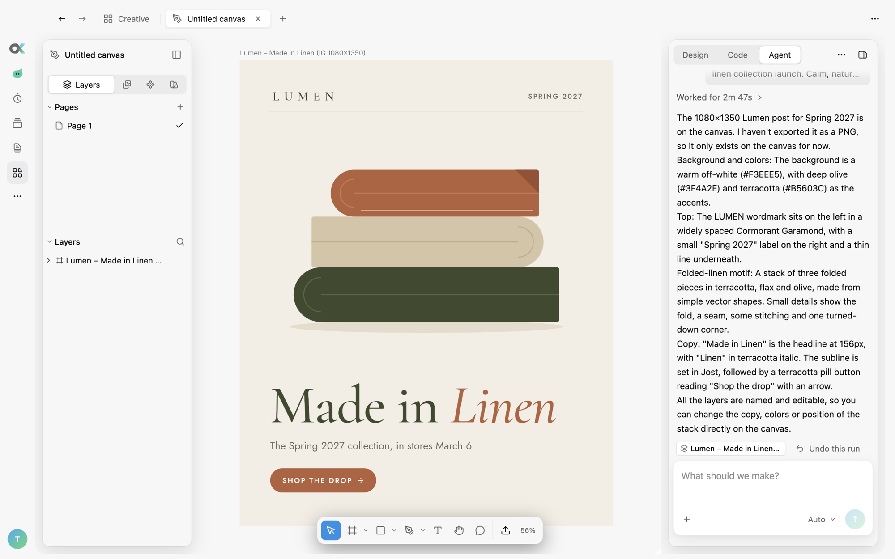
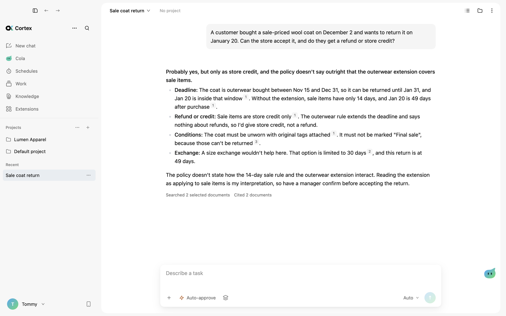
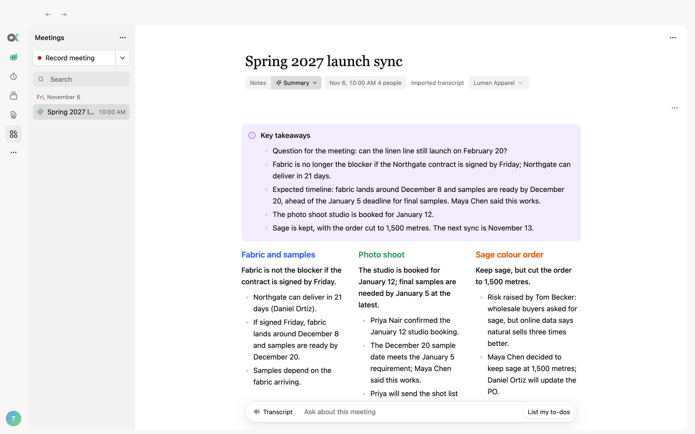
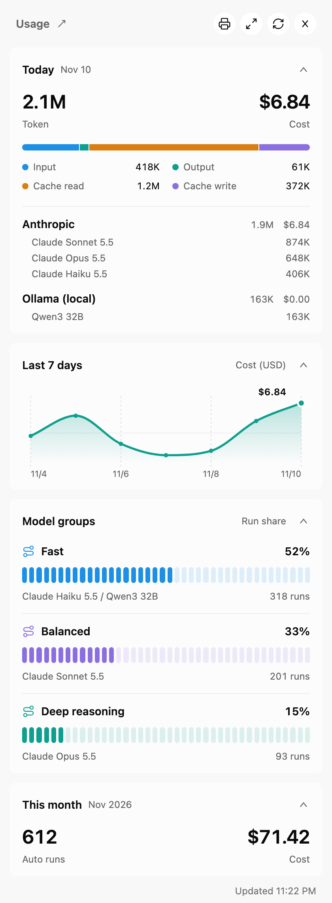
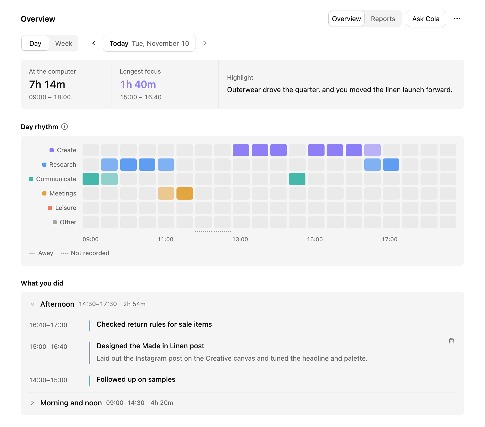

# Cortex

**不止于通用 AI 工作台。** 
你的模型、你的数据、你的电脑。本地优先的 AI 工作台，让智能体跨文件、可编辑文档、知识库、创意画布与团队聊天协同工作——始终由你掌控。

[English](README.md) · 简体中文

[-0ea5e9)](https://cortex.flock.io/#models)

 

  &nbsp;&nbsp;
  &nbsp;&nbsp;
  

[**官网**](https://cortex.flock.io) · [**帮助文档**](https://cortex.flock.io/docs/) · [**下载安装**](#下载安装) · [**为什么选择 Cortex**](#为什么选择-cortex) · [**核心亮点**](#核心亮点) · [**自动更新**](#自动更新) · [**联系我们**](mailto:hello@flock.io)

 

  

> [!NOTE]
> **免费下载，自带模型 API Key。** 对话、项目文件、知识库与会议记录默认保存在你的 Mac 本地。支持连接 Claude、GPT、Gemini、DeepSeek、Kimi、Qwen、GLM、MiniMax、Seedance 或任意 OpenAI 兼容端点。如需企业私有化部署或业务工作流定制，请联系 [**hello@flock.io**](mailto:hello@flock.io)。

---

## 为什么选择 Cortex

大多数智能体框架只停留在“模型 + 工具 + 提示词”的循环；**Cortex 是围绕这一循环构建的完整工作台。**

🏠 **本地优先，数据自主。** 对话、项目文件夹、知识库和设置均保存在你的 Mac 上。只有向你自行配置的模型服务商或在线连接器发起调用时，请求才会离开本机。会议录音转写与合同脱敏可完全在设备端离线完成。

🤖 **Cola：驻留在 Mac 与手机上的个人智能体。** Cola 在你的 Mac 上执行长期目标和定时例行任务（Routines），并在有进展或需要决策时主动汇报。出门在外也可通过 iPhone、微信、飞书 / Lark、钉钉或 Telegram 随时给它发消息。

📄 **可继续编辑的交付物，而非一次性聊天气泡。** 让智能体撰写报告、制作演示文稿、生成数据看板或设计海报——产出的是可与智能体并排继续编辑、随时撤销修改的真实文档与分层画布，支持一键导出 Word、PowerPoint、PDF、PNG、SVG 或 Figma。

⚡ **自带模型，约 400 ms 智能路由。** 使用你自己的 API Key 直接向模型服务商按量付费。开启自动模式后，[FLock.io](https://www.flock.io) 研发的轻量决策模型 `this-that` 会在约 400 ms 内为每一步挑选最合适的模型档位，省钱又省时间。

🛡️ **权限分层，关键操作先确认。** 每个会话可独立选择 **Ask for approval（询问确认）**、**Auto-approve（自动批准）** 或 **Plan（仅规划）**。涉及删除文件或对外发送消息等高风险步骤时，智能体会先停下来等待你拍板。

---

## 下载安装

  &nbsp;&nbsp;
  &nbsp;&nbsp;
  

| 平台 | 架构 | 安装包 | 状态 |
| :--- | :--- | :--- | :--- |
| **macOS 13+** (Ventura 及以上) | Apple Silicon (M1 / M2 / M3 / M4) | [**最新 `.dmg` 安装包**](https://github.com/FLock-io/cortex-releases/releases/latest) | ✅ 已发布 |
| **Windows** | x64 / ARM64 | 安装程序 | 🚧 即将推出 |
| **Linux** | x64 (`AppImage` / `.deb`) | 安装包 | 🚧 即将推出 |

### 安装步骤 (macOS)

1. 打开 [最新发布页 (Releases)](https://github.com/FLock-io/cortex-releases/releases/latest)，下载 `Cortex-<version>-arm64.dmg`。
2. 打开 `.dmg` 并将 **Cortex** 拖入 **Applications（应用程序）**。
3. 从应用程序启动 **Cortex**，按引导配置模型 API Key（也可先跳过，稍后在 **Settings › Models & providers** 中添加）。

当前安装包已通过 Apple Developer ID 签名与公证（Notarized）。办公与画布编辑器、本地语音模型及知识检索模型会在需要时按需下载，并通过固定哈希校验完整性。

---

## 核心亮点

### Cola：你的个人智能体

Cola 跨项目与会话与你协同工作。用自然语言描述一项例行任务——例如 *“每天早上 9 点汇总昨天的项目进展发给我”*——Cola 就会自动创建定时计划、按时运行，并在有更新或需要你拍板时通知你。

  

### 可编辑文档、演示文稿与数据看板

在对话中直接生成排版完整的文档、幻灯片与交互式数据看板。你可以随时手动修改内容、撤销智能体的任意一次编辑，并一键导出为 `.docx`、`.pptx`、PDF 或 HTML。

  

### 创意画布 (Creative Canvas)

内置于工作台的原生设计画布。生成节点即画板，任意图层都可作为参考图，历史版本完整保留在节点内。让智能体直接在画布上设计海报、社媒配图或页面布局——所有图层均保持命名清晰且可独立编辑。

  

### 带页码引用的知识库与本地会议纪要

将公司制度、合同与手册导入本地知识库，每次回答都会精确引用来源页码，并在展示前自动核验引用内容。会议录音在 Mac 本地完成转写与说话人区分，自动提炼决议与带负责人的待办事项。

  
  

### 模型路由与用量成本透明

在自动（Auto）模式下，轻量分类器会将不同任务自动分配给快速、均衡或深度推理模型组。用量面板实时统计今日 Token 与已知花费、7 日成本趋势以及各模型调用占比——全部在你的 Mac 本地计算。

  

### 电脑活动回顾与每日摘要

开启后，Cortex 会在本地记录你使用过的应用，并每 10 分钟生成一段简短的工作摘要。概览页展示今日用机时长、最长专注时段、按类别划分的日程节奏以及自然语言时间线。该功能默认关闭，可随时暂停、排除指定应用或清空记录。

  

*注：以上截图均使用虚构示例数据。*

---

## 自动更新

Cortex 支持自动更新。开启后，应用会在启动后及每 4 小时自动检查新版本，在后台静默下载，并在下次退出应用时完成安装。你也可以在 **Settings › Notifications & chats › Software update** 中手动检查更新。

每个版本的详细更新日志请查看 [**Releases**](https://github.com/FLock-io/cortex-releases/releases) 页面或官网 [**What’s new**](https://cortex.flock.io/docs/changelog/)。

---

## 系统要求

- **操作系统：** macOS 13 Ventura 或更高版本
- **处理器：** Apple Silicon (M1 / M2 / M3 / M4 系列芯片)
- **模型配置：** 至少配置一个模型服务商的 API Key，或连接本地 OpenAI 兼容服务（可在 **Settings › Models & providers** 中添加）

暂不支持 Intel 芯片 Mac、Windows 与 Linux。

---

## 企业定制与私有化部署

除标准桌面版外，**FLock.io** 还围绕企业每周运行的真实业务流程提供定制构建：

- **私有化部署** — 本地服务器（On-premises）、私有云（VPC）或完全离线安装包。
- **定制智能体工作流** — 对接内部系统的 MCP 连接器、行业专属 Skills 与人工审批节点。
- **专属行业模型** — 基于 Qwen、DeepSeek、GLM 等开源权重模型微调，或在不移动数据的前提下通过 FLock 联邦学习训练。
- **企业级分层权限** — 贴合组织架构的知识库、工具与高风险动作权限管控。

详情请访问 [**cortex.flock.io**](https://cortex.flock.io/#custom) 或发送邮件至 [**hello@flock.io**](mailto:hello@flock.io)。

---

## 支持与反馈

- **帮助中心：** [cortex.flock.io/docs](https://cortex.flock.io/docs/)
- **问题反馈与功能建议：** 请先搜索 [已有 Issues](https://github.com/FLock-io/cortex-releases/issues)，或 [新建 Issue](https://github.com/FLock-io/cortex-releases/issues/new) 并附上 Cortex 版本号、macOS 版本与复现步骤。
- **商务合作与定制咨询：** [hello@flock.io](mailto:hello@flock.io)

© 2026 [FLock.io](https://www.flock.io). 保留所有权利。
